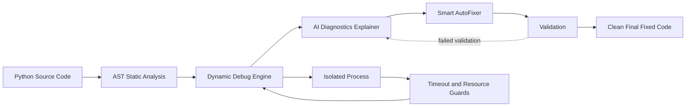

# CodeMind AI

> **AI-Powered Python Debugging System**
>
> Analyze. Explain. Fix.

CodeMind AI is an intelligent Python debugging workflow that combines static analysis, isolated runtime execution, AI-assisted diagnostics, and automatic repair. It turns a Python source file and its traceback into a clear explanation, an actionable fix, and cleaner final code.


*The image above illustrates the end-to-end CodeMind AI pipeline, from Python source code to validated fixed code.*

## Table of Contents

- [Why CodeMind AI](#why-codemind-ai)
- [Key Features](#key-features)
- [Architecture](#architecture)
- [Debugging Workflow](#debugging-workflow)
- [Installation](#installation)
- [Configuration](#configuration)
- [Usage](#usage)
- [Example](#example)
- [Safety and Security](#safety-and-security)
- [Project Structure](#project-structure)
- [Development](#development)
- [Testing](#testing)
- [Roadmap](#roadmap)
- [Contributing](#contributing)
- [License](#license)

## Why CodeMind AI

Traditional debugging often requires users to interpret dense tracebacks, locate the responsible code path, reproduce the failure, and design a safe patch manually. CodeMind AI streamlines this process by combining deterministic engineering tools with AI-generated insight:

- **Deterministic analysis** identifies syntax and structural problems.
- **Isolated execution** reproduces runtime failures without trusting user code.
- **AI diagnostics** translates technical errors into human-friendly explanations.
- **Smart AutoFix** proposes and applies targeted repairs.
- **Validation** checks the repaired result before presenting it as final code.

The system is designed for learners, developers, educators, and teams that want faster feedback without sacrificing execution safety or developer control.

## Key Features

### AI-Powered Intelligence

- Converts tracebacks and static-analysis findings into concise explanations.
- Identifies likely root causes instead of only reporting the final exception.
- Produces practical next steps and repair recommendations.

### AST Static Analysis

- Parses Python source code into an abstract syntax tree.
- Detects syntax and structural issues before execution.
- Provides a foundation for code-aware diagnostics and patch generation.

### Safe Isolated Execution

- Runs submitted code in a separate process.
- Keeps execution boundaries independent from the main application.
- Supports resource controls and failure isolation.

### Timeout Protection

- Prevents infinite loops and indefinitely blocked programs.
- Terminates executions that exceed the configured time limit.
- Reports timeouts as structured diagnostic events.

### Human-Friendly Explanations

- Rewrites technical tracebacks into understandable language.
- Highlights the relevant file, line, expression, and failure reason.
- Separates the diagnosis, explanation, and recommended action.

### Automatic Code Repair

- Generates focused patches rather than rewriting unrelated code.
- Applies intelligent fixes when confidence is sufficient.
- Preserves the developer's original intent as much as possible.

### Clean Final Output

- Returns repaired source code as a distinct result.
- Includes the detected issue, applied change, and validation status.
- Makes it easy to review, copy, or integrate the result into a project.

## Architecture

CodeMind AI follows a staged pipeline. Each stage has a clear responsibility and produces structured information for the next stage.



### Architectural Components

| Component | Responsibility | Output |
| --- | --- | --- |
| **Source Intake** | Accepts Python source and debugging options | Normalized source request |
| **AST Analyzer** | Parses and inspects code structure | Syntax and static findings |
| **Dynamic Debug Engine** | Executes code under controlled conditions | stdout, stderr, exit status, traceback |
| **Isolation Boundary** | Separates untrusted execution from the host process | Contained execution context |
| **Diagnostics Explainer** | Correlates static and runtime findings | Root cause and explanation |
| **Smart AutoFixer** | Generates a minimal repair | Candidate patch or revised source |
| **Validator** | Re-runs analysis and execution checks | Validation result and confidence |
| **Result Presenter** | Formats the final response for users or APIs | Explanation, patch, and fixed code |

## Debugging Workflow

1. **Python Source Code**
   - The user submits Python source code and optional execution context.

2. **AST Static Analysis**
   - CodeMind AI parses the source and inspects its structure before running it.
   - Parse failures are returned immediately with a precise location when available.

3. **Dynamic Debug Engine**
   - The code is executed in an isolated process.
   - Runtime output, exceptions, and tracebacks are captured for analysis.

4. **AI Diagnostics Explainer**
   - Static findings and runtime evidence are combined.
   - The system produces a plain-language explanation of what happened and why.

5. **Smart AutoFixer**
   - A focused patch is proposed or applied based on the diagnostic context.
   - The change should remain reviewable and limited to the suspected defect.

6. **Validation and Final Code**
   - The repaired source is parsed and, where appropriate, executed again.
   - The final response includes the validation status and the resulting code.

## Installation

### Prerequisites

- Python **3.10 or newer**
- `pip` and `venv`
- An AI provider API key, when AI diagnostics or AutoFix are enabled
- An operating-system environment that supports process isolation and subprocess timeouts

### Clone and Create a Virtual Environment

```bash
git clone <repository-url>
cd codemind-ai

python -m venv .venv

# Linux/macOS
source .venv/bin/activate

# Windows PowerShell
.venv\\Scripts\\Activate.ps1
```

### Install Dependencies

```bash
python -m pip install --upgrade pip
pip install -r requirements.txt
```

For development dependencies, install:

```bash
pip install -r requirements-dev.txt
```

If the project exposes a Python package configuration, an editable install is also recommended:

```bash
pip install -e .
```

## Configuration

Create a local environment file from the project's example configuration when available:

```bash
cp .env.example .env
```

Typical settings include:

```dotenv
# AI provider configuration
AI_PROVIDER=<provider-name>
AI_API_KEY=<your-api-key>
AI_MODEL=<model-name>

# Execution controls
EXECUTION_TIMEOUT_SECONDS=10
MAX_OUTPUT_BYTES=100000
MAX_SOURCE_BYTES=200000

# Application settings
LOG_LEVEL=INFO
ENVIRONMENT=development
```

Keep secrets out of source control. The exact provider and model names depend on the configured AI backend. If AI access is unavailable, static and dynamic debugging can still be used for deterministic diagnostics where supported by the implementation.

## Usage

The precise command or API entry point depends on the repository's application layer. A typical CLI workflow looks like this:

```bash
python -m codemind path/to/example.py
```

A typical file-based workflow may look like:

```bash
codemind debug path/to/example.py --timeout 10 --autofix
```

A typical programmatic integration follows this shape:

```python
from codemind import debug

result = debug(
    source="""
items = [1, 2, 3]
print(items[3])
""",
    timeout_seconds=10,
    autofix=True,
)

print(result.explanation)
print(result.fixed_code)
```

The returned result should expose, directly or through serialized fields:

- Static-analysis findings
- Runtime status and captured traceback
- Human-readable explanation
- Suggested or applied patch
- Fixed source code
- Validation status

## Example

Given this source:

```python
numbers = [1, 2, 3]
print(numbers[3])
```

CodeMind AI can identify the out-of-range index, explain that Python uses zero-based indexing, and suggest a focused correction such as:

```python
numbers = [1, 2, 3]
print(numbers[2])
```

The repaired result should be considered complete only after the validation stage confirms that the source parses and the relevant execution path no longer produces the original failure.

## Safety and Security

Running arbitrary Python code is inherently dangerous. Isolation must be treated as a core security boundary, not as a convenience feature.

Recommended safeguards:

- Execute untrusted code in a separate process or sandbox.
- Apply strict CPU, memory, wall-clock, and output-size limits.
- Run with the least-privileged operating-system user possible.
- Restrict filesystem, network, subprocess, and environment access according to the deployment threat model.
- Never expose host credentials or production secrets to executed code.
- Sanitize logs and error responses before returning them to users.
- Treat AI-generated patches as untrusted until they pass parsing, tests, and review.
- Do not use `exec` or `eval` on untrusted source in the application process.

The timeout shown in the architecture is necessary but not sufficient for production isolation. Containerization, OS-level sandboxing, or a dedicated execution service may be required for public-facing deployments.

## Project Structure

A recommended organization for the system is:

```text
codemind-ai/
├── codemind/
│   ├── intake/          # Request normalization and source handling
│   ├── static_analysis/ # AST parsing and structural checks
│   ├── runtime/         # Isolated execution and timeout controls
│   ├── diagnostics/     # Traceback correlation and explanations
│   ├── autofix/          # Patch generation and application
│   ├── validation/      # Re-analysis and post-fix verification
│   └── api/              # CLI, HTTP, or integration interfaces
├── tests/
│   ├── unit/
│   ├── integration/
│   └── fixtures/
├── .env.example
├── requirements.txt
├── requirements-dev.txt
├── pyproject.toml
└── README.md
```

Adapt the directory names to the implementation as the codebase evolves; the architectural boundaries should remain explicit even if modules are organized differently.

## Development

Activate the virtual environment, install development dependencies, and run the application using the repository's supported entry point.

Recommended quality checks:

```bash
pytest
ruff check .
ruff format --check .
```

For type checking, when configured:

```bash
mypy codemind
```

When adding a new debugging capability, cover both the normal path and failure modes such as invalid syntax, runtime exceptions, timeouts, oversized output, and unsuccessful patch validation.

## Testing

A robust test suite should include:

- Valid Python programs that complete successfully.
- Syntax errors with accurate line and column reporting.
- Common runtime exceptions and nested tracebacks.
- Infinite loops and timeout termination.
- Large stdout and stderr output.
- Malformed or low-confidence AI responses.
- Patches that fail to parse or do not resolve the original failure.
- Regression cases proving unrelated source code is preserved.
- Permission and isolation checks for the execution boundary.

## Roadmap

- [ ] Stable CLI and/or HTTP API contract
- [ ] Pluggable AI provider adapters
- [ ] Structured diagnostics schema
- [ ] Patch diff and review interface
- [ ] Test-aware AutoFix validation
- [ ] Container-based execution worker
- [ ] Project-level debugging across multiple files
- [ ] IDE and editor integrations
- [ ] Metrics for fix confidence and validation success

## Contributing

Contributions are welcome. Before opening a pull request:

1. Create a focused branch.
2. Add or update tests for behavior changes.
3. Run the formatter, linter, and test suite.
4. Document configuration or API changes.
5. Include a concise explanation of the architectural impact.

Please avoid committing API keys, generated secrets, user source code, or execution logs containing sensitive data.

## License

Add the repository's official license here once selected. Until then, treat the source as private and do not redistribute it without permission.

---

**CodeMind AI — Smarter Debugging. Stronger Code.**
